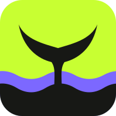

<p align="center">
  
</p>

<h1 align="center">ФНСКит</h1>

<p align="center">
  Документы для ФНС — в нужном формате и без возни с настройками.<br>
  PDF и многостраничный TIFF с правильными разрешением, цветом и сжатием.
</p>

<p align="center">
  
  
  
</p>

---

## Что это

ФНСКит готовит файлы для налоговой. Выбираете, куда отправляете документ, загружаете сканы, PDF или фотографии — и получаете один многостраничный файл с параметрами, которые требует ФНС. Без регистрации и без установки программ.

> Сервис не является официальным продуктом ФНС России и не заменяет консультацию бухгалтера или юриста.

## Как это работает

1. **Выберите задачу** — ответ на требование ФНС и НДС или регистрация ООО и ИП.
2. **Загрузите страницы** — PDF, JPG, PNG или TIFF, расставьте их в нужном порядке.
3. **Скачайте файл** — один PDF или TIFF с проверенными параметрами.

## Возможности

- **Готовые профили.** «НДС и требования ФНС» — 300 DPI, 8 бит, оттенки серого, LZW. «Регистрация ООО и ИП» — 300 DPI, 1 бит, чёрно-белый, CCITT Group 4. Есть и свой профиль: выбираете DPI, цвет и сжатие сами.
- **PDF или TIFF.** TIFF доступен во всех профилях, PDF — в профиле для НДС и требований.
- **Всё в одном файле.** До 200 страниц и 100 МБ за раз; несколько файлов можно собирать в отдельных вкладках.
- **Проверка результата.** После сборки сервис сверяет разрешение, цвет, сжатие и число страниц.
- **Просмотр TIFF в браузере.** Файл открывается локально и никуда не отправляется.
- **Инструкции.** Как ответить на требование ФНС, зарегистрировать ООО, открыть ИП и сделать многостраничный TIFF.
- **Файлы не хранятся.** Всё, что вы загрузили, удаляется сразу после обработки. Готовый TIFF или PDF можно сохранить в кабинет компании — только по вашей кнопке и в зашифрованном виде.
- **Кабинет компании.** Постоянные документы ИП и ООО, сроки с напоминаниями, ссылки для отправки и пакет под запрос банка или контрагента — один ZIP с описью.

## Быстрый старт

Нужны Docker и Docker Compose.

```bash
git clone https://github.com/sherhn/FNSKit.git
cd FNSKit
cp .env.example .env
docker network create dokploy-network   # один раз
docker compose --env-file .env -f backend/docker-compose.yml up --build -d
```

Сайт откроется на <http://localhost:8082>. Остановить:

```bash
docker compose --env-file .env -f backend/docker-compose.yml down
```

В `.env.example` только пределы и настройки обработки, секретов в проекте нет.

## Что в репозитории

| Папка | Содержимое |
| --- | --- |
| `site/` | сайт: страницы, редактор, просмотрщик TIFF |
| `backend/` | сервис обработки документов и настройки запуска |
| `docs/` | [описание дизайна](docs/DESIGN.md), [стек технологий](docs/STACK.md) |

Подробности запуска и деплоя — в [backend/README.md](backend/README.md).

## Статус и планы

Это прототип: сайт закрыт от индексации, а страницы политики и согласия на обработку персональных данных пока заглушки. Дальше в планах:

- подсказки по электронной подписи;
- контроль сроков ответа, подписи и доверенностей;
- метрики, журналы и резервные копии.

## Лицензия

[MIT](LICENSE). Шрифт Manrope распространяется по лицензии SIL OFL.
